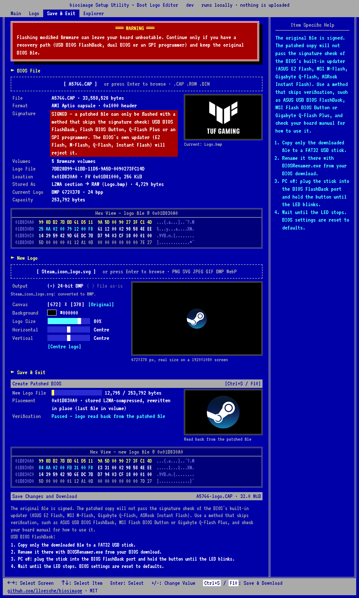
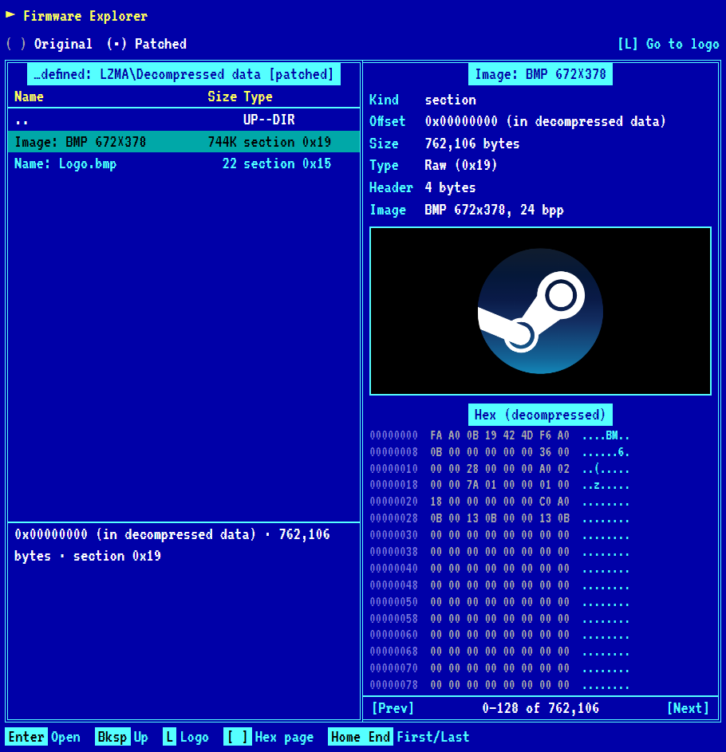

# biosimage

Replace the boot logo in AMI Aptio / UEFI firmware images, such as the `.CAP` BIOS files
ASUS publishes for its mainboards.

**Use it in your browser: <https://lloesche.github.io/biosimage/>**. Drop in your BIOS file
and an image (PNG, SVG, JPEG, ...), position the logo, and download the patched BIOS.
Everything runs locally in WebAssembly; nothing is uploaded.



A read-only, Norton Commander style **firmware explorer** shows the structure of the image
(volumes, files, sections, checksums, compressed volumes, embedded images) with a hex view, for
the original and the patched file, so you can see exactly what changed:



There is also a command-line tool:

```console
$ biosimage info A5766.CAP
File:     A5766.CAP (33558528 bytes)
Capsule:  AMI Aptio capsule, 0x1000-byte header
Signed:   YES (AMI Aptio capsule)
          A patched file can only be flashed with a method that skips the signature check:
          ASUS USB BIOS FlashBack, MSI Flash BIOS Button, Gigabyte Q-Flash Plus or an SPI
          programmer. The BIOS's own updater (ASUS EZ Flash, MSI M-Flash, Gigabyte
          Q-Flash, ASRock Instant Flash) rejects it because it no longer matches the
          signature.
Volumes:  5 top-level firmware volume(s)
Formats:  BMP (current logo), JPEG (logo code reads it)
Free:     3739072 bytes in the main volume at 0x1001000 for a logo moved there
          (experimental: replace -free-space)

Logo 1:   file 7BB28B99-61BB-11D5-9A5D-0090273FC14D at 0x1b830a0 (4729 bytes) in volume at 0x1b81000 (256 KiB)
  Stored:   LZMA section → RAW (Logo.bmp)
  Image:    BMP 672x378, 24 bpp, 762104 bytes
  Capacity: up to 253792 bytes for a replacement file

$ biosimage replace A5766.CAP mylogo.bmp -o A5766-mylogo.CAP
```

> [!WARNING]
> Flashing modified firmware can brick your board. Only use this if you have a recovery
> path (e.g. ASUS USB BIOS FlashBack, a dual BIOS, or an SPI programmer) and keep the
> original file. You use this tool at your own risk.

## Install

Download a binary from the [releases](https://github.com/lloesche/biosimage/releases), or

```sh
go install github.com/lloesche/biosimage@latest
```

## Usage

```
biosimage info    FIRMWARE                       show where and how the logo is stored
biosimage extract [-o FILE] FIRMWARE             save the current logo image
biosimage replace [-o FILE] [-no-compress] [-free-space] [-force] FIRMWARE IMAGE
```

- `replace` writes `FIRMWARE-logo.<ext>` unless `-o` is given; it never overwrites the input.
- `-no-compress` stores the image uncompressed even if the original was LZMA-compressed.
- `-free-space` moves the logo into the free space of the main volume (experimental, see
  [More space](#more-space-experimental)).
- `-force` inserts the image despite warnings (see below), and writes the file despite an
  [Intel Boot Guard](#intel-boot-guard) warning.
- `-guid` targets a file other than the standard logo file.

## Preparing the image

AMI's setup module (AMITSE) draws the logo. It reads BMP itself and passes every other image to
a format test that looks at the file's first bytes. Which formats the test knows depends on how
the vendor built AMITSE: on the tested boards JPEG always, PNG and GIF only on some (see
[Tested with](#tested-with)). An AMITSE often contains more decoders than its logo code uses,
for its setup screens or as dead code, so biosimage reads the logo code itself: it disassembles
AMITSE, follows the code from where it names the logo file to the format test, and reads which
signatures the test compares. `biosimage info` lists the formats a BIOS can show: BMP and the
format of the current logo always, the others when the logo code reads them. The web app
offers these formats and starts with the format of the current logo; JPEG is much smaller than
BMP, which matters where the logo is stored uncompressed or space is tight. While you edit, it
shows how much space the new logo file takes in the BIOS, stored the way the patched BIOS will
store it, and tells you before you build if it does not fit. For the most predictable result:

- Use a **24-bit uncompressed BMP** on a black background.
- Size: the logo must not be larger than the screen while the board starts. AMITSE switches to
  the screen mode closest to the logo's size and shows no logo if it is still larger, so stay
  at or below 1920x1080. A logo of at most 40 % of the screen's width and height is drawn a
  little above the centre (its middle at 38 % of the height), a larger one centred. The
  original logos are sized for this: ASUS's 672x378 is 35 % of 1920x1080. (Traced in the
  AMITSE of the ASUS TUF GAMING B850I WIFI NEO.)
- PNG: 8- or 16-bit, **no alpha channel**, not interlaced.
- JPEG: **baseline** (not progressive), 1:1 pixel density.
- GIF: where the logo code reads GIF, AMITSE plays animated GIFs (min. 100 ms per frame, no
  disposal methods, endless loop), but a vendor's boot path may show only the first frame. It plays only while
  the board starts up (POST), usually a few seconds. The web app's GIF
  output takes care of this: it places every frame on the canvas, uses one palette of up to
  256 colours and needs no disposal method, as every frame is opaque and drawn over the last.
  Faster animations either keep their speed (frames are dropped to play at most 10 per second)
  or keep all frames (and play more slowly). Frames are stored either as the area that changed
  since the last one (smaller) or complete (in case a board does not place partial frames
  correctly). AMITSE waits for a frame's delay before drawing that frame, so each frame stays
  for the next frame's delay; the web app moves the delays one frame back, so that frames are
  shown as long as in a browser. "File as-is" inserts a GIF unchanged.

`biosimage replace` checks for these and refuses images it expects to fail unless you pass
`-force`.

With ImageMagick, a transparent logo can be centred on a black 672x378 canvas like this:

```sh
magick logo.png -background black -alpha remove -alpha off -resize 300x300 \
       -gravity center -extent 672x378 -type TrueColor BMP3:mylogo.bmp
```

Size limit: the logo lives in a small firmware volume (128–320 KiB on the tested boards) and the
stored, compressed file must fit (`biosimage info` shows the capacity). Flat-colour logos compress to a few dozen KiB; photos may not
fit.

## More space (experimental)

The logo's own space is small: 36 KiB to 388 KiB on the tested boards (see
[Tested with](#tested-with)). The main volume (FV_MAIN) has megabytes free on all of them. The
**Use free space** option of the web app (`replace -free-space`) adds the logo there as a new,
uncompressed file and turns the original logo file into padding.

This works because AMI's setup module, AMITSE, does not look for the logo in a particular
place: it reads the logo file from whichever firmware volume has it. biosimage checks this in
the machine code of each BIOS's AMITSE: it disassembles the code around the Firmware Volume 2
protocol and looks for the loop that reads the logo's raw section from every volume. It also
requires the firmware's ROM layout table to mark the main volume for the DXE phase, the same
way as the volumes the logo comes from today. Only then does it offer the option. It has not
been tried on a running board yet, so keep a recovery path. If it does not work, expect the
board to boot without a logo.

The same way, the vendor tests check that AMITSE plays GIF animations at no more than 10 frames
per second (delays under 100 ms are raised to 100 ms). All 10 tested BIOSes whose logo code
reads GIF have this limit.

### Intel Boot Guard

Intel Boot Guard verifies the boot block when the board powers on. AMI firmware can also keep a
hash of the main volume in the boot block, which then checks the main volume against it. A board
that enforces Boot Guard does not start a BIOS whose verified parts changed. Whether a board
enforces it is fused into the chipset and cannot be read from the BIOS file, but the file shows
whether the vendor set it up (a key manifest and a boot policy manifest) and what the hash
covers. Among the tested boards:

- Gigabyte Z790 AORUS ELITE AX: set up, and the main volume, which holds the logo, is
  hash-verified. A patched BIOS will very likely not start.
- ASUS NUC 14 Pro: set up; what it verifies is unknown. A patched BIOS may not start.

`info` shows this, `replace` refuses to write such a file unless `-force` is given, and the web
app asks for confirmation before it builds one. Only go ahead if you can restore the original
BIOS without booting the board: Gigabyte Q-Flash Plus, MSI Flash BIOS Button, ASUS USB BIOS
FlashBack, a dual BIOS or an SPI programmer.

## Flashing

Vendor BIOS files are **signed**, either as a capsule (ASUS `.CAP`) or with an AMI signature
block embedded in the image (MSI, Gigabyte, ASRock). Changing the logo invalidates the
signature, so the BIOS's own updater (ASUS EZ Flash, MSI M-Flash, Gigabyte Q-Flash, ASRock
Instant Flash) will reject the file. You need a flashing method that does not verify it:

- **ASUS:** USB BIOS FlashBack. Rename the file with the `BIOSRenamer.exe` that comes with the
  BIOS download (do this on a USB stick that contains only the modified `.CAP`, so the
  renamer cannot pick up the original), plug the stick into the FlashBack port and press the
  button.
- **MSI:** Flash BIOS Button; **Gigabyte:** Q-Flash Plus; **ASRock**, **NZXT**, **Biostar**:
  BIOS Flashback, on boards that have it. Each needs the file renamed as described in the board
  manual. Sapphire's and EVGA's downloads include AMI/Intel flash tools; check whether your board
  has a flashback feature before relying on them.
- Otherwise an SPI programmer.

These methods write the whole chip, so expect your BIOS settings to be reset. Only ASUS has
been flashed and confirmed so far; the other vendors are verified on the file level only.

## How it works

1. Find all firmware volumes (`_FVH` headers with a valid checksum), including uncompressed
   volumes nested inside files. On many boards (Gigabyte, ASRock, NZXT, Sapphire, MSI AM5, ASUS
   NUC) AMI keeps the logo in a small volume wrapped in a RAW file inside the main volume.
2. Find the FFS file `7BB28B99-61BB-11D5-9A5D-0090273FC14D` (`gEfiDefaultBmpLogoGuid`), which
   EDK2 and AMI use for the boot logo, and decode it. Supported layouts: a raw file, an
   uncompressed `EFI_SECTION_RAW`, or a raw section inside an LZMA GUID-defined section
   (`EE4E5898-3914-4259-9D6E-DC7BD79403CF`). Other encapsulations (Tiano compression, Brotli)
   are replaced with an uncompressed section.
3. If there is no such file in an uncompressed volume, decompress LZMA-compressed volumes and
   look there (MSI on Intel and older AMD, Biostar and EVGA keep the logo only in their
   compressed main volume).
4. Rebuild the file with the new image, keeping the other sections (e.g. the name) and the
   original LZMA properties. The LZMA stream is written in the same form as EDK2's
   `LzmaCompress`: explicit size, no end-of-stream marker. If the original was stored
   uncompressed and the new image does not fit that way (EVGA), it is wrapped in an LZMA
   section, which the firmware reads the same way.
5. Put it back into the volume, in the first way that works: in place if it is the last file or
   still fits its slot (remainder filled with a pad file); appended to the free space with the
   old slot turned into a pad file; or grown in place with the following files moved towards
   the end, keeping their data alignment (never moving files marked as fixed). A compressed
   volume is recompressed and placed back the same way, and the data checksums of enclosing
   files are updated.
6. Verify: all file checksums are valid, all other files are byte-identical, nothing else
   changed, and a fresh parse of the whole patched image finds every logo with the new image.

Limitations: biosimage's LZMA encoder compresses 10–20 % worse than the vendors' tools, so a
recompressed main volume grows (MSI PRO Z790-A: 5.5 MB → 6.2 MB, MSI MAG Z890: 5.2 MB → 6.2 MB);
it must still fit into the free space of its volume. Not supported: more than one logo file per
volume. Changes to a volume that Intel Boot Guard verifies are detected (see
[Intel Boot Guard](#intel-boot-guard)), not avoided.

## Tested with

These images are tested by the [vendor firmware workflow](.github/workflows/firmware.yml)
whenever the parsing code or the list changes. It downloads them from the vendors' servers
and checks them against pinned hashes (see [`testdata/firmware.json`](testdata/firmware.json)).

| Vendor | Board | Platform | BIOS | Logo | Space | Free space | Formats | Result |
|---|---|---|---|---|---|---|---|---|
| ASUS | TUF GAMING B850I WIFI NEO | AM5 | 1804 | logo volume | 248 KiB | 3.6 MiB | BMP, JPEG | ✅ patched and flashed via USB BIOS FlashBack |
| ASUS | TUF GAMING B550-PLUS | AM4 | 3645 | logo volume, 2 copies | 148 KiB | 6.4 MiB | BMP, JPEG | ✅ patched |
| ASUS | PRIME Z790-P | Intel LGA1700 | 1836 | logo volume | 225 KiB | 2.8 MiB | BMP, JPEG | ✅ patched |
| ASUS | PRIME Z890-P | Intel LGA1851 | 3212 | logo volume | 348 KiB | 3.8 MiB | BMP, JPEG | ✅ patched |
| ASUS | NUC 14 Pro (NUC14RV) | Intel Meteor Lake | 0044 | nested volume | 256 KiB | – | BMP | ✅ patched |
| MSI | MAG B650 TOMAHAWK WIFI | AM5 | 7D75v1R3 | nested volume | 320 KiB | 5.0 MiB | BMP, JPEG, GIF | ✅ patched |
| MSI | B450 TOMAHAWK MAX | AM4 | 7C02v3M5 | compressed main volume, 2 copies | 78 KiB | 2.9 MiB | BMP, JPEG, GIF | ✅ patched |
| MSI | PRO Z790-A WIFI | Intel LGA1700 | 7E07vAJ | compressed main volume | 61 KiB | 1.9 MiB | BMP, JPEG, GIF | ✅ patched |
| MSI | MAG Z890 TOMAHAWK WIFI | Intel LGA1851 | 7E32v1AD | compressed main volume | 36 KiB | 2.3 MiB | BMP, JPEG, PNG | ✅ patched |
| MSI | MPG Z490 GAMING EDGE WIFI | Intel LGA1200 | 7C79v1F1 | compressed main volume | 227 KiB | 3.9 MiB | BMP, JPEG, GIF | ✅ patched |
| Gigabyte | X870 AORUS ELITE WIFI7 | AM5 | F13g | nested volume | 128 KiB | 6.4 MiB | BMP, JPEG, PNG, GIF | ✅ patched |
| Gigabyte | B550 AORUS ELITE V2 | AM4 | F20c | nested volume, 2 copies | 128 KiB | 4.2 MiB | BMP, JPEG, PNG, GIF | ✅ patched |
| Gigabyte | Z790 AORUS ELITE AX | Intel LGA1700 | FP | nested volume | 128 KiB | 5.4 MiB | BMP, JPEG, PNG, GIF | ✅ patched |
| Gigabyte | Z490 AORUS ELITE | Intel LGA1200 | F25a | nested volume | 128 KiB | 2.0 MiB | BMP, JPEG, PNG, GIF | ✅ patched |
| ASRock | B650M Pro RS | AM5 | 4.60 | nested volume | 128 KiB | 3.5 MiB | BMP, JPEG, PNG | ✅ patched |
| ASRock | Z790 Pro RS | Intel LGA1700 | 19.03 | nested volume | 128 KiB | 246 KiB | BMP, JPEG, PNG, GIF | ✅ patched |
| Biostar | B650M-SILVER | AM5 | B65BQ730 | compressed main volume | 388 KiB | 4.5 MiB | BMP, JPEG | ✅ patched |
| Sapphire | NITRO+ B850A WIFI 7 | AM5 | AM50N101R30 | nested volume | 128 KiB | 4.8 MiB | BMP, JPEG | ✅ patched |
| NZXT | N7 Z890 | Intel LGA1851 | 3.13 | nested volume | 128 KiB | 5.2 MiB | BMP, JPEG, PNG, GIF | ✅ patched |
| EVGA | Z790 DARK K\|NGP\|N | Intel LGA1700 | 1.11 | compressed main volume, uncompressed logo | 50 KiB | 3.9 MiB | BMP, JPEG, PNG | ✅ patched |

"Patched" means the image is patched and fully verified on the file level; only the first board
has been flashed so far.

Reports for other boards are welcome; please include the output of `biosimage info`.

## Development

```sh
go test ./...
BIOSIMAGE_FIRMWARE=/path/to/bios.cap go test ./...   # also run against a real image
```

The test suite builds synthetic firmware volumes, so no vendor binaries are needed or
included. To also test against the vendor images in `testdata/firmware.json` (downloaded from
the vendors' servers and verified by SHA-256 on first use):

```sh
BIOSIMAGE_FIRMWARE_CACHE=~/.cache/biosimage-firmware go test ./uefi -run TestVendorFirmware -v
```

Vendor firmware is never committed or uploaded as a CI artifact; it is not ours to
redistribute.

### Web app

The web app in [`web/`](web) is plain HTML/CSS/JavaScript; the firmware code is the same Go
package compiled to WebAssembly ([`cmd/wasm`](cmd/wasm)), which runs in a Web Worker
([`web/worker.js`](web/worker.js)) so that decompressing and recompressing firmware does not
block the page; it reports its progress to it. To run it locally:

```sh
go run ./cmd/buildweb -serve    # builds web/biosimage.wasm and serves http://localhost:8080
```

## License

MIT, see [LICENSE](LICENSE).
